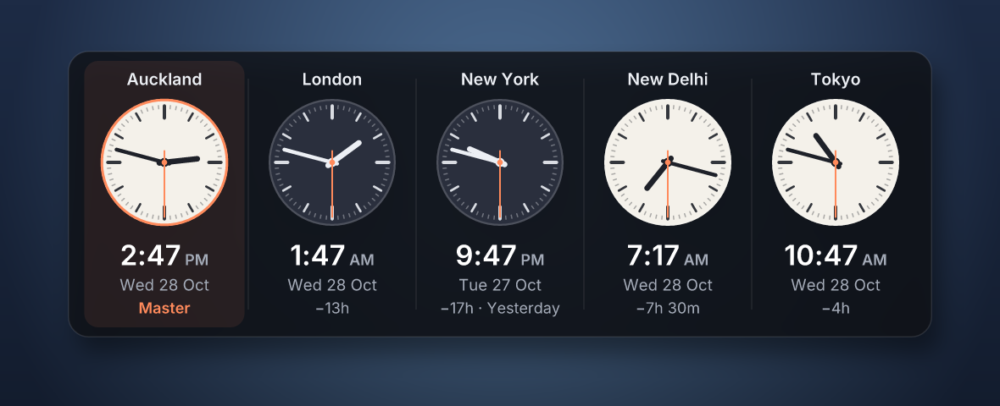
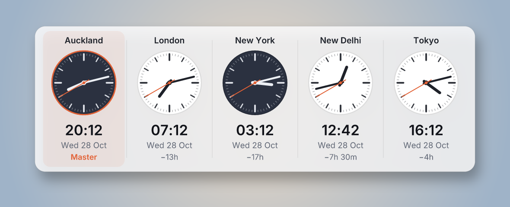
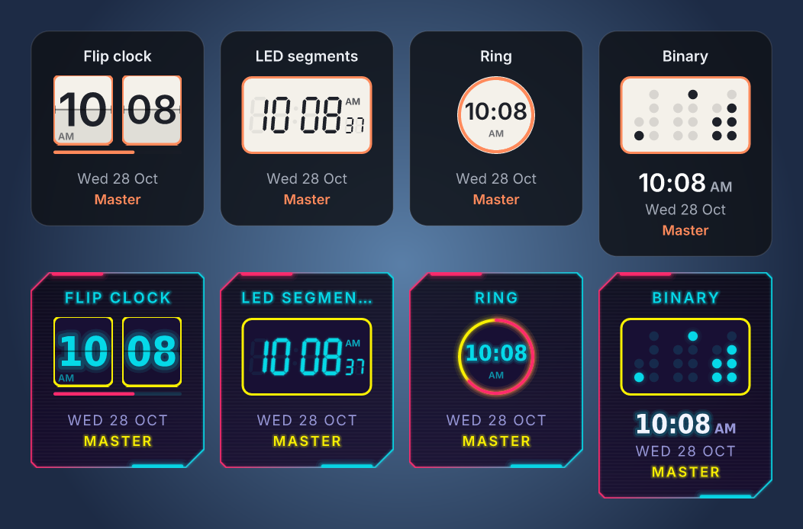
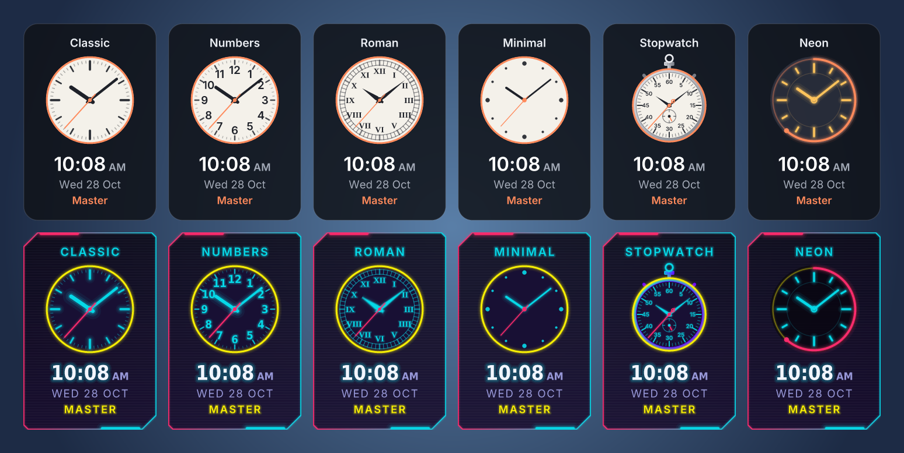
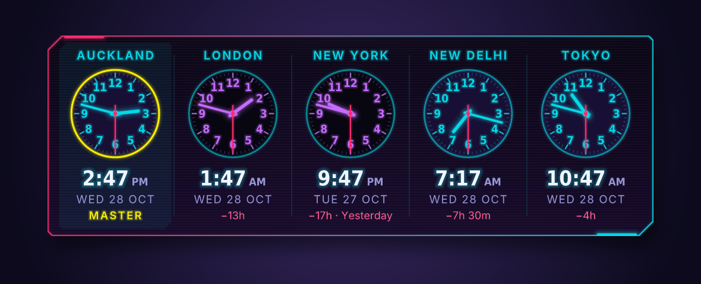

# World Clock Widget

A small Windows desktop widget that shows up to five analog clocks side by side. Under each clock you get the digital time, the day and date in that time zone, and how far ahead or behind it is from your **master** clock.



- **Up to 5 clocks**, each with an analog dial, digital time, day and date
- **Time difference from a master clock** (`+11h`, `−5h 30m`, `−17h · Yesterday`), and daylight saving is handled automatically
- **Day and night faces**: a dial turns dark between 6pm and 6am in its own zone
- **Stays in a fixed spot**: drag it where you want, then lock it. It can sit on the desktop behind your windows, act like a normal window, or stay always on top
- **Runs all the time**: starts with Windows, sits in the tray, and has no taskbar button
- **Small**: one exe under 2 MB, no installer and no runtime. It only redraws the clock hands each second; the faces and text are cached and redrawn once a minute
- **Analog or digital**: six analog face designs, or four digital layouts including a flip clock whose cards flip down when the minute changes
- **Make it yours**: Dark, Light and Cyberpunk themes, and your own colours from the Windows colour picker
- **Any size from 1 to 100**: presets at 25, 50 (normal), 75 and 100 (twice as big), or a custom size with a live-preview slider
- 12 or 24-hour time, and sharp on high-DPI screens



## Getting it

**Download:** grab `world-clock.exe` from the [Releases](../../releases) page, put it somewhere permanent (for example `C:\Users\<you>\Apps\WorldClock\`) and double-click it. Windows SmartScreen may warn about an unsigned app the first time; choose **More info → Run anyway**.

**Build it yourself** (needs [Rust](https://rustup.rs)):

```powershell
git clone https://github.com/nihalkaler/world-clock-widget
cd world-clock-widget
cargo build --release
.\target\release\world-clock.exe
```

On first launch it appears in the top-right corner with your own time zone plus London, New York and Tokyo, and turns on **Start with Windows**.

## Make it yours

**Analog or digital.** Right-click → **Clock type** → **Analog** (the default) or **Digital**. Digital clocks have four layouts under **Digital layout**:

| Layout | Looks like |
| --- | --- |
| Flip clock | Split-flap cards for the hours and minutes. When a number changes, the top flap folds down and the new one drops into place. A thin bar under the cards fills up over each minute |
| LED segments | A seven-segment display like a bedside alarm clock, with small seconds and a blinking colon |
| Ring | Big digits inside a ring that fills up with the seconds |
| Binary | Each digit as lit dots in binary (hours, minutes, seconds), with the normal time written underneath |



Digital clocks follow the same themes, colours, 24-hour and **Show seconds** settings as analog ones, and take up a little less height. The flip animation runs at about 60 frames a second only while a card is turning; the rest of the time the widget still redraws just once a second.

**Clock faces.** For analog clocks, right-click → **Clock face** changes every clock. Right-click one clock → **This clock's face** gives just that clock its own design.



| Face | Looks like |
| --- | --- |
| Classic | Tick marks for every minute and hour (the default) |
| Numbers | The hours written 1 to 12 |
| Roman | Roman numerals with a railway-track minute ring |
| Minimal | Just dots and slim hands |
| Stopwatch | An old pocket stopwatch: crown, side pushers, a 5–60 scale and a small 24-hour dial that tells 9am from 9pm |
| Neon | Glowing rings, with the seconds sweeping round the rim as an arc |

**Themes.** Right-click → **Theme**: Dark (the default), Light, or **Cyberpunk**, which has neon magenta and cyan with a glow, a cut-corner HUD panel with scanlines, and Bahnschrift digits.



**Your own colours.** Right-click → **Colours** opens the Windows colour palette for each part of the widget: background, accent (second hand and master clock), text, day and night clock faces, and day and night hands. Your picks sit on top of whichever theme you choose, and a tick in the menu shows which ones you've changed. **Reset to the theme's colours** puts them back.

## Using it

| To do this | Do this |
| --- | --- |
| Move the widget | Drag it with the left mouse button |
| Change a clock's city | Right-click that clock → **Change time zone** |
| Measure differences from a different clock | Right-click it → **Master clock** |
| Add or remove a clock | Right-click → **Add a clock** / **Remove this clock** |
| Keep it behind windows, normal, or on top | Right-click → **Placement** |
| Stop accidental dragging | Right-click → **Lock position** |
| Change the size | Right-click → **Size** → 25, 50, 75 or 100, or **Custom** to drag a slider or type any number from 1 to 100. The widget resizes as you drag; **Cancel** puts it back |
| Switch between analog and digital | Right-click → **Clock type** |
| Change face or digital layout, theme, colours, 24-hour time, seconds | Right-click → the matching item |
| Reach the menu when the widget is covered | Click the clock icon in the system tray |

The **Change time zone** menu has about 100 cities grouped by region, plus "This PC's time zone", which follows your computer's time zone setting (handy when you travel).

In **On the desktop** placement the widget stays behind your other windows. When you press Win+D or click the wallpaper, it comes forward so you can see it.

## Settings file

Everything is saved to `%APPDATA%\WorldClockWidget\config.toml`. Right-click → **Edit settings file…** opens it in Notepad, and changes appear within a second of saving. You can use any [IANA time zone](https://en.wikipedia.org/wiki/List_of_tz_database_time_zones) here, and rename a clock with `label`:

```toml
master = 1            # clock the differences are measured from (1 = leftmost)
use_24_hour = false
second_hand = true
size = 50             # 1 to 100: 50 is normal, 100 is twice as big, 1 is a quarter
theme = "dark"        # dark | light | cyberpunk
display = "analog"    # analog | digital
dial = "classic"      # analog face: classic | numbers | roman | minimal | stopwatch | neon
digital = "flip"      # digital layout: flip | segment | ring | binary
layer = "desktop"     # desktop | normal | top
locked = false
opacity = 0.85        # background, 0.3 to 1.0

[colors]              # optional; anything left out comes from the theme
accent = "#2EC4B6"    # also: background, text, day_face, night_face, day_hands, night_hands

[[clock]]
zone = "local"        # this PC's time zone

[[clock]]
label = "Mum & Dad"
zone = "Asia/Kolkata"
dial = "stopwatch"    # optional: this clock's own face

[[clock]]
label = "Team (NYC)"
zone = "America/New_York"
```

If the file has a mistake, the widget tells you what and where, and keeps using the last good settings.

## Removing it

Right-click → untick **Start with Windows** → **Exit**, then delete the exe and the `%APPDATA%\WorldClockWidget` folder.

## How it works

Written in Rust with no GUI framework:

| File | What it does |
| --- | --- |
| `src/win.rs` | The Win32 side, through `windows-sys`: a per-pixel-alpha layered window, tray icon, menus, the Windows colour picker (`ChooseColor`), the Custom size dialog (built from an in-memory dialog template, with a slider that resizes the widget live), start-with-Windows (registry `Run` key), single-instance guard, per-monitor DPI, and z-order handling for desktop placement |
| `src/render.rs` | Draws the widget with [`tiny-skia`](https://github.com/RazrFalcon/tiny-skia) into a pixel buffer, which is handed to Windows with `UpdateLayeredWindow`. Themes are palettes, custom colours override them, and each face design draws its own marks and hands (glow is layered translucent strokes) |
| `src/digital.rs` | The digital layouts. Flip cards are drawn as small images; while one flips, its top half is squashed towards the hinge and then the new bottom half unfolds, each clipped to its half with a mask |
| `src/text.rs` | Turns glyph outlines into anti-aliased paths with [`ab_glyph`](https://github.com/alexheretic/ab-glyph), with letter spacing and glow, using fonts Windows already has (Segoe UI, Bahnschrift, Georgia) so none are bundled |
| `src/clock.rs` | Time-zone maths with [`jiff`](https://github.com/BurntSushi/jiff), which bundles the IANA time-zone database on Windows so daylight-saving rules are correct |
| `src/config.rs` | Settings: TOML load/save, defaults, and keeping values in range |
| `src/cities.rs` | The city list behind the menus |
| `build.rs`, `resources/` | Embeds the exe icon and an application manifest (modern-style controls, per-monitor DPI) |

Because drawing is platform independent, the widget can also be rendered to a PNG on any OS. That's how the screenshots above were made:

```sh
cargo run --release -- --preview out.png --at 2026-10-28T01:47:30Z --local Pacific/Auckland --scale 1.5 --theme cyberpunk --dial numbers
```

Run the tests with `cargo test`. They cover daylight-saving changes, half- and quarter-hour zones (India, Nepal, Chatham Islands), "yesterday/tomorrow" across the date line, settings parsing (including files from older versions), custom colours, the seven-segment table, that every theme, face design and digital layout renders, and that every city in the menu is a real time zone.

## Licence

MIT
